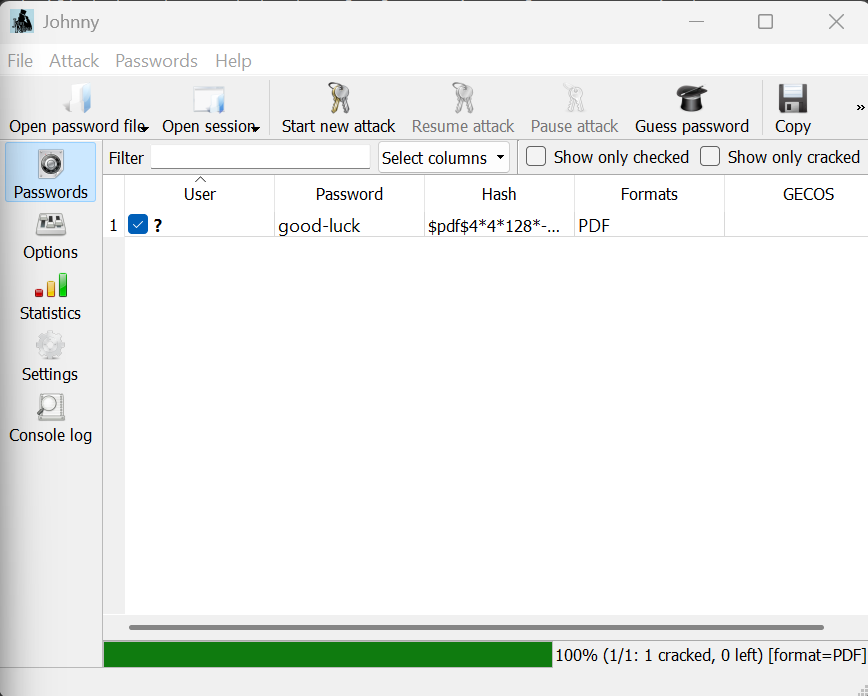
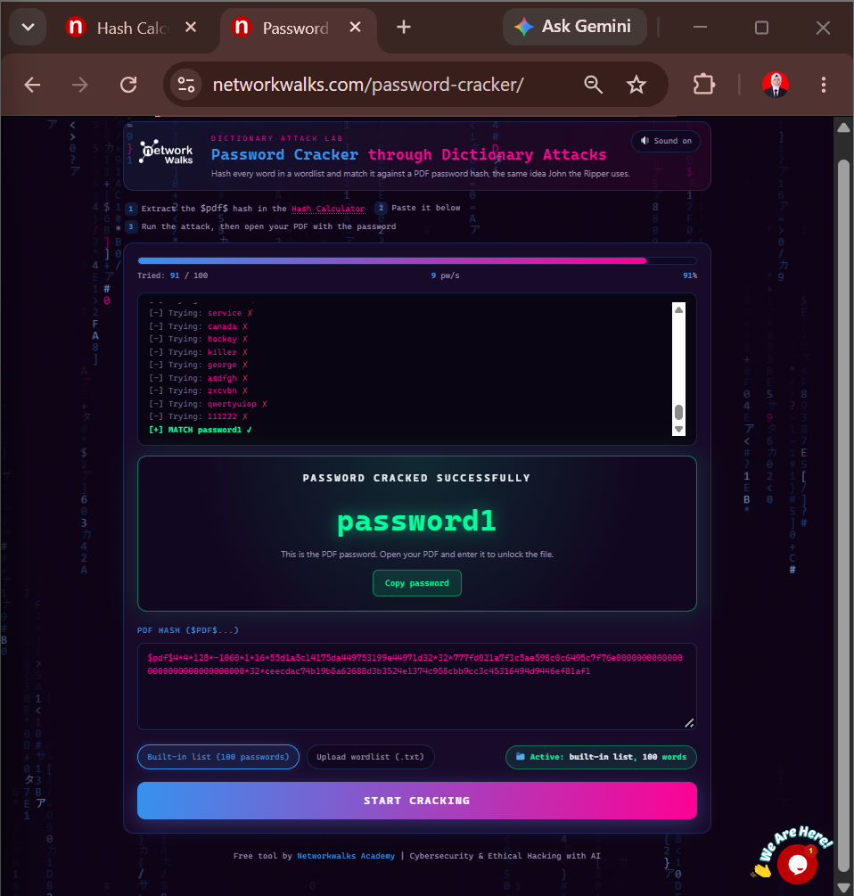
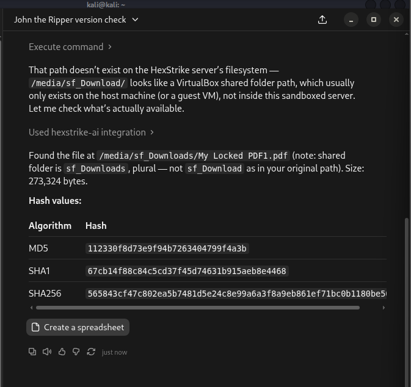

# NetworkWalks Cybersecurity Internship — Week 3
## Password Cracking: JTR, NetworkWalks Tools, and an AI-Driven Approach

This repo documents how I worked through Week 3 of the NetworkWalks Cybersecurity & Ethical Hacking Internship. The task on paper was simple: crack the password of a locked PDF. In practice, it turned into three different ways of solving the same problem — plus a fair share of troubleshooting I didn't see coming.

---

## What I actually worked on

### 1. PM1 — John the Ripper (via Johnny GUI)

The first task was to crack `My Locked PDF1.pdf` using John the Ripper on Windows, with Johnny as the graphical front-end.

**How I did it:**
1. Downloaded John the Ripper (1.9.0-jumbo-1, 64-bit Windows build) and extracted it — no install needed.
2. Downloaded and installed Johnny, then pointed it at `john.exe` inside the `run` folder.
3. Extracted the PDF's hash using an online PDF hash extractor (`$pdf$...` format) and saved it to a text file.
4. Loaded the hash file into Johnny and started the attack.

**Hash extracted:**

**Challenge:** After loading the hash, the attack just sat at 0% — nothing happening.

**Solution:** The attack mode wasn't set to use a wordlist. I switched it to **Wordlist** mode under Options and pointed it at `fasttrack.txt`, then restarted the attack — it finished in seconds.

**Password found:** `good-luck`

**Verified by opening the PDF:**

---

### 2. PM2 — NetworkWalks Hash Calculator & Password Cracker

The second task used NetworkWalks Academy's own browser-based tools instead of installing anything — a different PDF this time (`My Locked PDF1 (for NW Tools Lab WK3-PM2).pdf`).

**How I did it:**
1. Dropped the PDF into the Hash Calculator tool, which extracted the `$pdf$...` hash directly in the browser.
2. Pasted that hash into the Password Cracker tool and ran the dictionary attack.

**Hash calculated:**

**Password cracked:**

**Password found:** `password1`

**Verified by opening the PDF:**

---

### 3. Extra practice — PDF2 and PDF3

Not required, but I wanted more reps with the JTR + Johnny workflow before moving to the AI-assisted part.

**PDF2** — same hash-extract-and-crack process as PM1:

 PDF2/01_Extra_PDF2_HashExtracted.png>)
 PDF2/02_Extra_PDF2_Johnny_Cracked.png>)
 PDF2/03_Extra_PDF2_PDF_Opened.png>)

Password found: `password1`

**PDF3** — needed a bigger wordlist than the first two; `fasttrack.txt` didn't have it, so I switched to `JTR_default_password.txt`:

 PDF3/01_Extra_PDF3_HashExtracted.png>)
 PDF3/02_Extra_PDF3_Johnny_Cracked.png>)
 PDF3/03_Extra_PDF3_PDF_Opened.png>)

Password found: `1qaz2wsx`

---

### 4. Optional — Letting an AI run the attack

This was the part that took the most work to set up, but was the most interesting to actually use. The idea: instead of clicking through Johnny myself, I'd set up **Claude Desktop** on Kali Linux, connect it to a **Hexstrike-AI MCP server**, and crack a PDF just by typing plain-English instructions.

**Setting it up wasn't exactly plug-and-play.** The official guide said to run `sudo apt install claude-desktop`, but that package no longer exists — it's been renamed to `claude-desktop-unofficial`. Even after installing it, typing `claude-desktop` in the terminal gave me `command not found`. I had to dig into the installed files with `dpkg -L claude-desktop-unofficial | grep bin` to find out the actual command was `claude-desktop-unofficial`.

Once Claude Desktop was running, I cloned the Hexstrike-AI repo, built a Python virtual environment, and started its server. Wiring Claude Desktop to that server meant editing `claude_desktop_config.json` — except that file already had a bunch of existing settings in it, so instead of risking breaking it by hand-editing in `nano`, I wrote a small Python script to merge in just the `mcpServers` block.

The lab's official target file (`networkwalks_flag1.pdf`) also turned out to be missing from the shared Google Drive — I checked every folder I could find and reached out to the instructor, but it wasn't available. Rather than stall, I used `My Locked PDF1.pdf` (the same file from PM1) to demonstrate the exact same workflow.

**From there, the actual cracking was just a conversation:**

Asked Claude to check if John the Ripper was available on the server:

Asked it to calculate the PDF's hash — it even caught and corrected a typo in the file path I gave it (`sf_Download` → `sf_Downloads`):

Asked it to run John the Ripper against the hash using `rockyou.txt` (which I had to decompress first with `sudo gunzip -k`, since it was still a `.gz` file on Kali):

**Password found:** `good-luck` — cracked in under 6 seconds, at roughly 173,000 password attempts per second.

---

## Challenges & how I solved them

| What went wrong | How I fixed it |
|---|---|
| Johnny's attack stuck at 0% cracked | Switched the attack mode to Wordlist before restarting |
| `sudo apt install claude-desktop` — package doesn't exist anymore | Found and installed the renamed package: `claude-desktop-unofficial` |
| `claude-desktop` command not found after install | Searched installed files (`dpkg -L ... \| grep bin`) to find the real command name |
| Kali VM screen froze mid-install | Waited it out — the install had actually completed successfully in the background |
| Claude's config file already had other settings in it | Wrote a short Python script to merge in the new MCP config instead of overwriting by hand |
| Typo'd the shared folder path (`sf_Download` vs `sf_Downloads`) | Claude caught the mismatch itself and found the correct path |
| `rockyou.txt` was still compressed | Decompressed it with `gunzip` before running the attack |
| Official AI-lab target PDF wasn't in the shared Drive | Used an existing locked PDF to demonstrate the same method instead of stalling |

---

## What this week actually taught me

Every password here was cracked almost instantly — `password1`, `good-luck`, `1qaz2wsx` — which says more about password habits than it does about the tools. John the Ripper, a browser tool, and an AI agent all arrived at the same answer through the same basic idea: hash the guess, compare it, repeat.

The more useful skill, honestly, wasn't the cracking — it was working through broken docs, a renamed package, and a missing file without just stopping. That's closer to what real security work probably looks like than any single tool is.

---

**Program:** NetworkWalks Cybersecurity & Ethical Hacking Internship
**Instructor:** Waqas Karim (CCIE)
**Week:** 3 — Password Cracking
