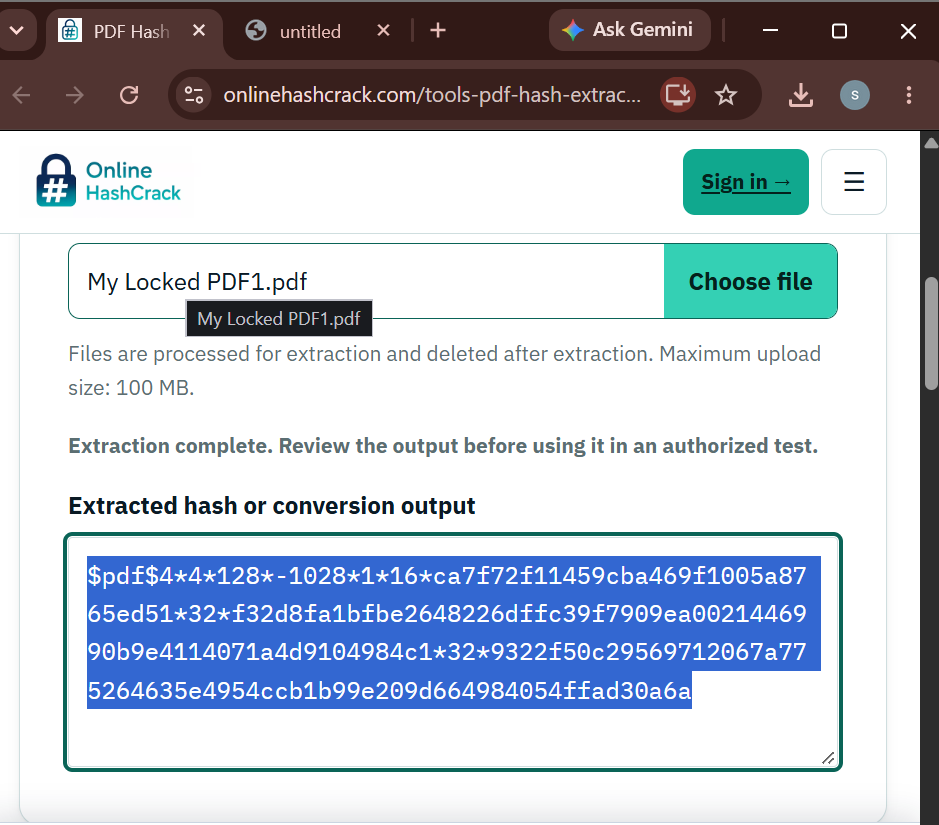
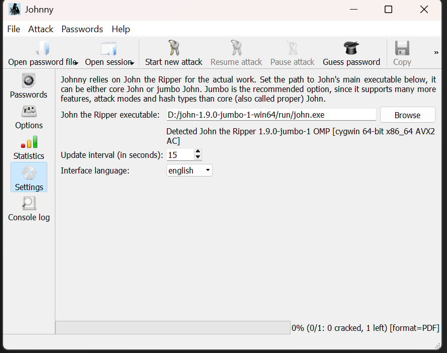
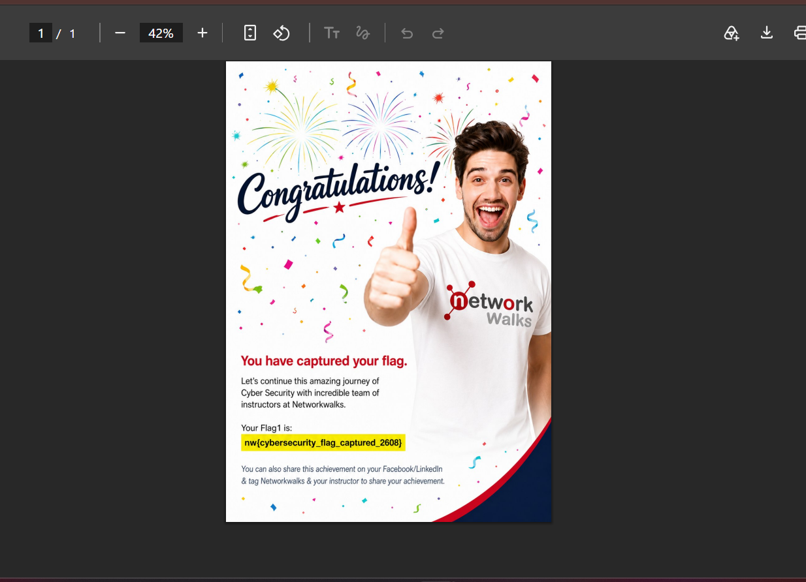
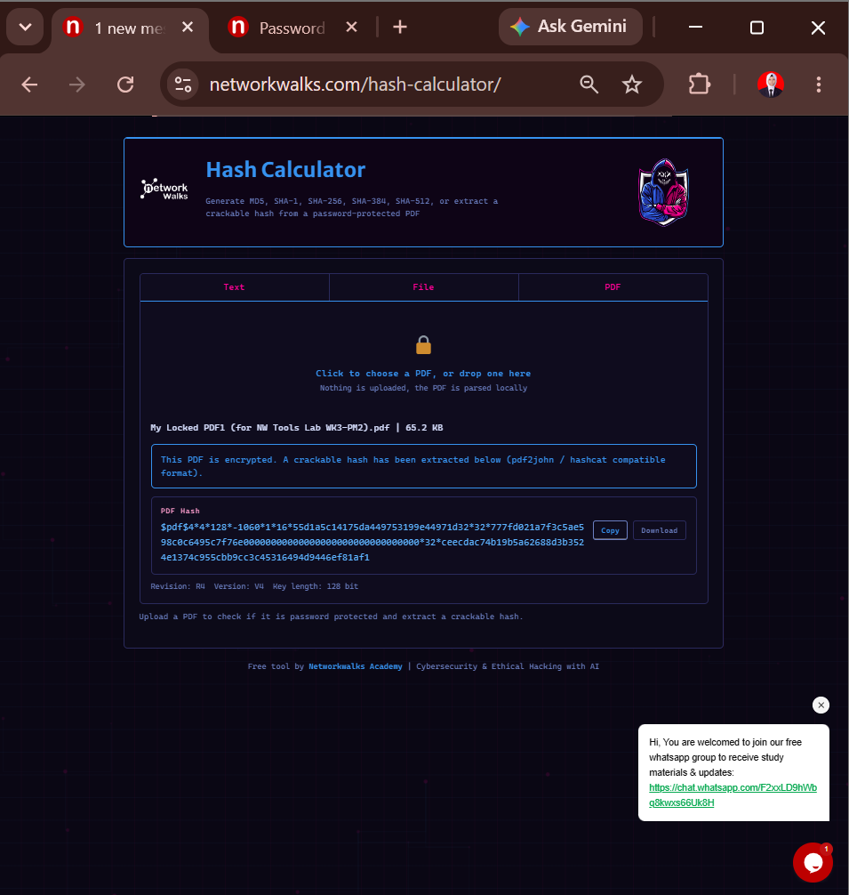
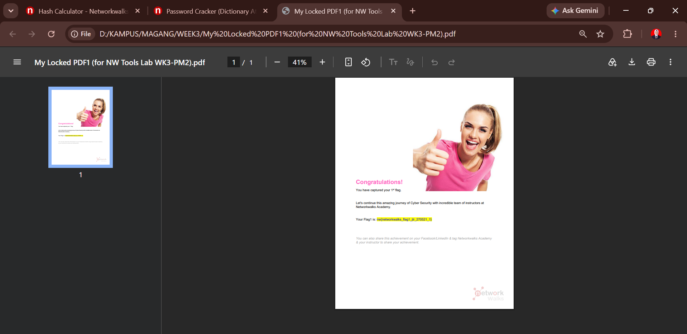
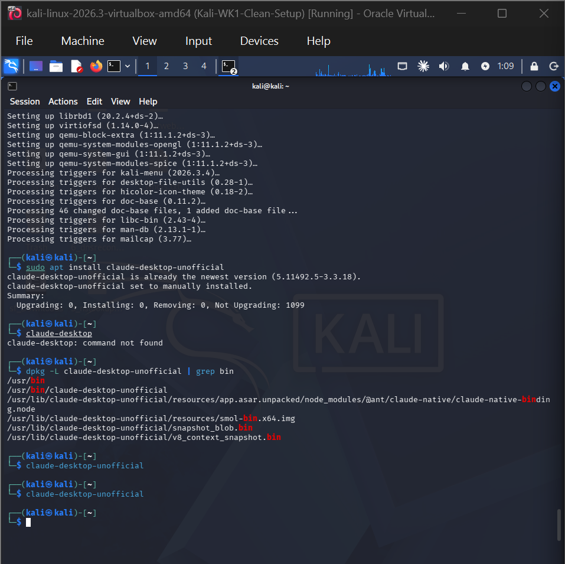
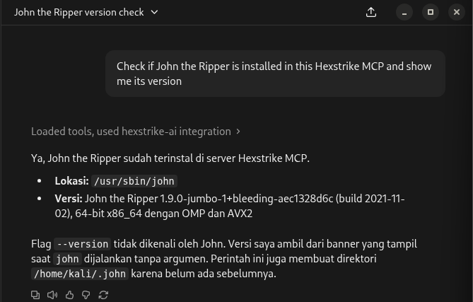
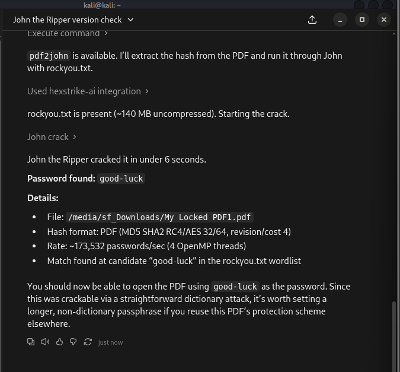

# 🔑 Password Cracking Lab
**John the Ripper, NetworkWalks Tools, and an AI-Driven Approach**

    

*NetworkWalks Cybersecurity & Ethical Hacking Internship · Batch B084 · Week 3*

---

## 📌 Project Overview

This repo documents how I worked through Week 3 of the NetworkWalks Cybersecurity & Ethical Hacking Internship. The task on paper was simple: crack the password of a locked PDF. In practice, it turned into three different ways of solving the same problem, each with its own share of troubleshooting I didn't see coming.

> ⚠️ **Ethics & scope:** every PDF cracked in this repo was provided by NetworkWalks specifically for this exercise. No system, account, or file outside this lab was tested or accessed.

---

## 🎯 What I Worked On

- [x] **PM1** — Crack `My Locked PDF1.pdf` using John the Ripper via the Johnny GUI
- [x] **PM2** — Crack a second locked PDF using NetworkWalks' own browser-based Hash Calculator and Password Cracker
- [x] **Extra practice** — PDF2 and PDF3, repeating the JTR + Johnny workflow for more reps
- [x] **Optional** — Set up a Hexstrike AI MCP server on Kali Linux, connected to Claude Desktop, and cracked a PDF through plain-English instructions

---

## 1. PM1 — John the Ripper (via Johnny GUI)

The first task was to crack `My Locked PDF1.pdf` using John the Ripper on Windows, with Johnny as the graphical front end.

**How I did it:**
1. Downloaded John the Ripper (1.9.0-jumbo-1, 64-bit Windows build) and extracted it. No install needed.
2. Downloaded and installed Johnny, then pointed it at `john.exe` inside the `run` folder.
3. Extracted the PDF's hash using an online PDF hash extractor (`$pdf$...` format) and saved it to a text file.
4. Loaded the hash file into Johnny and started the attack.

**Hash extracted:**

**Challenge:** after loading the hash, the attack just sat at 0%. Nothing was happening.

**Solution:** the attack mode wasn't set to use a wordlist. I switched it to **Wordlist** mode under Options, pointed it at `fasttrack.txt`, and restarted the attack. It finished in seconds.

**Password found:** `good-luck`

**Verified by opening the PDF:**

---

## 2. PM2 — NetworkWalks Hash Calculator & Password Cracker

The second task used NetworkWalks Academy's own browser-based tools instead of installing anything, this time on a different PDF, `My Locked PDF1 (for NW Tools Lab WK3-PM2).pdf`.

**How I did it:**
1. Dropped the PDF into the Hash Calculator tool, which extracted the `$pdf$...` hash directly in the browser.
2. Pasted that hash into the Password Cracker tool and ran the dictionary attack.

**Hash calculated:**

**Password cracked:**

**Password found:** `password1`

**Verified by opening the PDF:**

---

## 3. Extra Practice — PDF2 and PDF3

Not required, but I wanted more reps with the JTR and Johnny workflow before moving to the AI-assisted part.

**PDF2**, same hash-extract-and-crack process as PM1:

Password found: `password1`

**PDF3** needed a bigger wordlist than the first two. `fasttrack.txt` didn't have it, so I switched to `JTR_default_password.txt`:

Password found: `1qaz2wsx`

---

## 4. Optional — Letting an AI Run the Attack

This was the part that took the most work to set up, but was the most interesting to actually use. The idea was to stop clicking through Johnny myself, set up **Claude Desktop** on Kali Linux, connect it to a **Hexstrike AI MCP server**, and crack a PDF just by typing plain English instructions.

**Setting it up wasn't exactly plug-and-play.** The official guide said to run `sudo apt install claude-desktop`, but that package no longer exists. It had been renamed to `claude-desktop-unofficial`. Even after installing it, typing `claude-desktop` in the terminal gave me `command not found`. I had to dig into the installed files with `dpkg -L claude-desktop-unofficial | grep bin` to find out the actual command was `claude-desktop-unofficial`.

Once Claude Desktop was running, I cloned the Hexstrike-AI repo, built a Python virtual environment, and started its server. Wiring Claude Desktop to that server meant editing `claude_desktop_config.json`. That file already had a bunch of existing settings in it, so instead of risking breaking it by hand editing in `nano`, I wrote a small Python script to merge in just the `mcpServers` block.

The lab's official target file, `networkwalks_flag1.pdf`, also turned out to be missing from the shared Google Drive. I checked every folder I could find and reached out to the instructor, but it wasn't available. Rather than stall, I used `My Locked PDF1.pdf`, the same file from PM1, to demonstrate the exact same workflow.

**From there, the actual cracking was just a conversation:**

Asked Claude to check if John the Ripper was available on the server:

Asked it to calculate the PDF's hash. It even caught and corrected a typo in the file path I gave it (`sf_Download` → `sf_Downloads`):

Asked it to run John the Ripper against the hash using `rockyou.txt`, which I had to decompress first with `sudo gunzip -k`, since it was still a `.gz` file on Kali:

**Password found:** `good-luck`, cracked in under 6 seconds, at roughly 173,000 password attempts per second.

---

## 🧯 Challenges & How I Solved Them

| What went wrong | How I fixed it |
|---|---|
| Johnny's attack stuck at 0% cracked | Switched the attack mode to Wordlist before restarting |
| `sudo apt install claude-desktop`, package doesn't exist anymore | Found and installed the renamed package, `claude-desktop-unofficial` |
| `claude-desktop` command not found after install | Searched installed files (`dpkg -L ... \| grep bin`) to find the real command name |
| Kali VM screen froze mid-install | Waited it out. The install had actually completed successfully in the background |
| Claude's config file already had other settings in it | Wrote a short Python script to merge in the new MCP config instead of overwriting by hand |
| Typo'd the shared folder path (`sf_Download` vs `sf_Downloads`) | Claude caught the mismatch itself and found the correct path |
| `rockyou.txt` was still compressed | Decompressed it with `gunzip` before running the attack |
| Official AI-lab target PDF wasn't in the shared Drive | Used an existing locked PDF to demonstrate the same method instead of stalling |

---

## 📚 Lessons Learned

Every password here was cracked almost instantly: `password1`, `good-luck`, `1qaz2wsx`. That says more about password habits than it does about the tools. John the Ripper, a browser tool, and an AI agent all arrived at the same answer through the same basic idea: hash the guess, compare it, repeat.

The more useful skill honestly wasn't the cracking itself. It was working through broken docs, a renamed package, and a missing file without just stopping. That feels closer to what real security work actually looks like than any single tool does.

---

**NetworkWalks Cybersecurity & Ethical Hacking Internship · Instructor: Waqas Karim CCIE**
*Week 3 — Password Cracking*

